# Perfumes+ — User Manual

A step-by-step guide to the Perfumes+ perfume wholesale trading platform.

Perfumes+ helps a trading desk turn supplier offers into profitable, funded deals:
import supplier price lists, match them to a product master, rank suppliers, size
each buy in USD, capture customer demand, place purchase orders, track what
physically arrives, invoice, and measure the real cash return on every deal.

Postgres is the authoritative record of everything. Excel is used only to import
and export.

- **Who this is for:** buyers (purchasing), sellers (sales), warehouse staff,
  accountants, managers and administrators.
- **What you need:** a web browser and a login. There is nothing to install.
- **Where it runs:** a hosted web address (for example
  `https://pafam2.onrender.com`) or your organisation's own deployment.

> The screenshots in this manual come from a fully populated demo dataset (four
> suppliers, eight perfumes, live offers, deals, orders, receipts, invoices and
> financing). Your own data will differ, but every screen works the same way.

---

## Contents

1. [Signing in](#1-signing-in)
2. [The dashboard and navigation](#2-the-dashboard-and-navigation)
3. [Importing supplier offers](#3-importing-supplier-offers)
4. [Clearing the exception queue](#4-clearing-the-exception-queue)
5. [Supplier offers and the offer detail page](#5-supplier-offers-and-the-offer-detail-page)
6. [The supplier scorecard](#6-the-supplier-scorecard)
7. [The product master](#7-the-product-master)
8. [Comparing price lists](#8-comparing-price-lists)
9. [Observed supply](#9-observed-supply)
10. [Exchange rates](#10-exchange-rates)
11. [Customer pricing](#11-customer-pricing)
12. [Price and supply trends](#12-price-and-supply-trends)
13. [The CP/SP calculator](#13-the-cpsp-calculator)
14. [Sizing a deal](#14-sizing-a-deal)
15. [Opportunity ranking](#15-opportunity-ranking)
16. [Exposure and caps](#16-exposure-and-caps)
17. [Customers](#17-customers)
18. [Customer demand](#18-customer-demand)
19. [Quotes](#19-quotes)
20. [Notes (Plaud / reMarkable / manual)](#20-notes-plaud--remarkable--manual)
21. [Follow-up tasks](#21-follow-up-tasks)
22. [Purchase orders](#22-purchase-orders)
23. [Goods receipts, PFI and fill rate](#23-goods-receipts-pfi-and-fill-rate)
24. [Inventory](#24-inventory)
25. [Supplier claims and returns](#25-supplier-claims-and-returns)
26. [Cash flow, invoices and financing](#26-cash-flow-invoices-and-financing)
27. [KPIs](#27-kpis)
28. [Alerts](#28-alerts)
29. [Audit log](#29-audit-log)
30. [Roles and what each one can see](#30-roles-and-what-each-one-can-see)
31. [Everyday workflows](#31-everyday-workflows)

---

## 1. Signing in

Open the web address and you will see the sign-in screen.

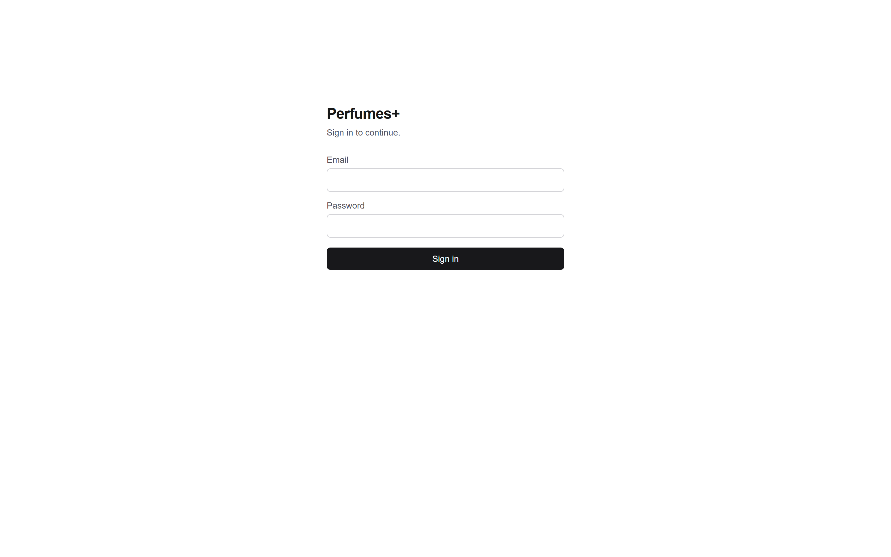

1. Type your **Email**.
2. Type your **Password**.
3. Click **Sign in**.

If the sign-in fails, an error message appears under the fields — usually a
typo in the email or password. Contact your administrator if you have forgotten
your password.

**Demo accounts.** The demo dataset includes one account per role:

| Email | Role |
| --- | --- |
| `admin@pafam2.local` | Administrator |
| `manager@pafam2.local` | Manager |
| `purchasing@pafam2.local` | Purchasing (buyer) |
| `sales@pafam2.local` | Sales |
| `accounts@pafam2.local` | Accounts |
| `warehouse@pafam2.local` | Warehouse |

Their password is `demo-password` unless your administrator set a different
`DEMO_PASSWORD`. The administrator account uses the `ADMIN_PASSWORD` configured
on the server.

---

## 2. The dashboard and navigation

After signing in you land on the **trading dashboard**.

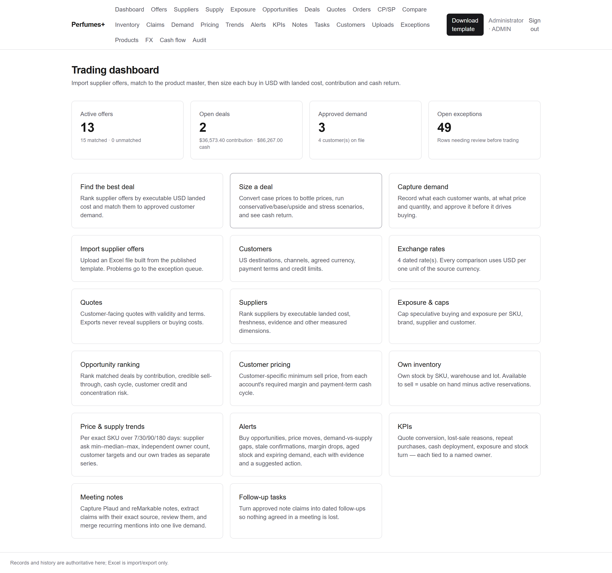

**The top bar** holds the main navigation. Only the areas your role allows are
shown. Click any item to open it; the item you are on is highlighted. Your name
and role appear on the right, with a **Sign out** link.

**The dashboard** gives you the current picture at a glance:

- **Active offers** — how many supplier offers are live, and how many have been
  matched to a product.
- **Open deals** — how many deals are in progress, their total contribution, and
  the cash they require.
- **Approved demand** — how much customer demand has been approved and how many
  customers are on file.
- **Open exceptions** — rows from imports that still need review.

Below the counters are shortcut cards that jump to the most common tasks:
*Find the best deal*, *Size a deal*, *Capture demand*, *Import supplier offers*,
*Customers*, *Exchange rates*, *Quotes*, *Suppliers*, *Exposure & caps*,
*Opportunity ranking*, *Customer pricing* and *Own inventory*.

**Every list screen** follows the same pattern: a heading, a short explanation,
a **New …** button top-right where you can create a record, and a table. Click
any row to open its detail page.

---

## 3. Importing supplier offers

Supplier offers arrive as Excel files. Importing them is the first step in the
whole workflow.

1. Open **Uploads** in the top bar.
2. If you do not have a file yet, click **Download template** (also in the top
   bar) to get the exact column layout we expect.
3. Choose your file and click **Import**.

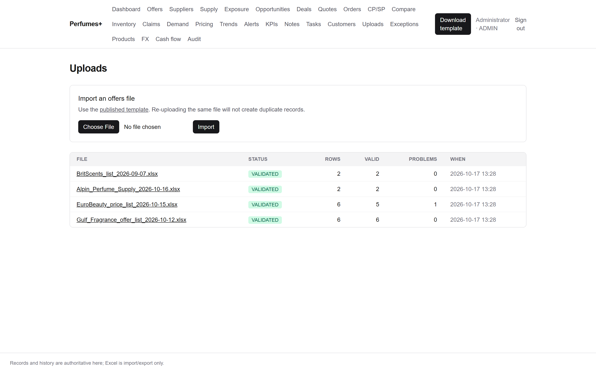

Each import appears in the list with a **status**:

- **VALIDATED** — the file was read; the **Rows**, **Valid** and **Problems**
  columns tell you how it went.
- **Problems** greater than zero means some rows need attention in the exception
  queue (see the next section).

Re-uploading the same file will **not** create duplicate records.

Open an import to see exactly what happened:

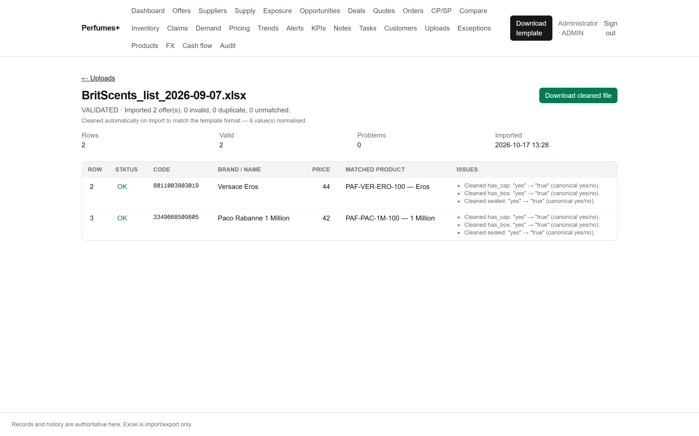

- **Rows / Valid / Problems** summarise the file.
- The **Cleaned automatically on import** note lists small normalisations Perfumes+
  made to match the template (for example `"yes"` → `"true"`).
- Each row shows its **status**, the raw **code**, **brand / name**, **price**,
  the **matched product**, and any **issues**.

---

## 4. Clearing the exception queue

Anything an import could not resolve lands in the **Exception queue**.

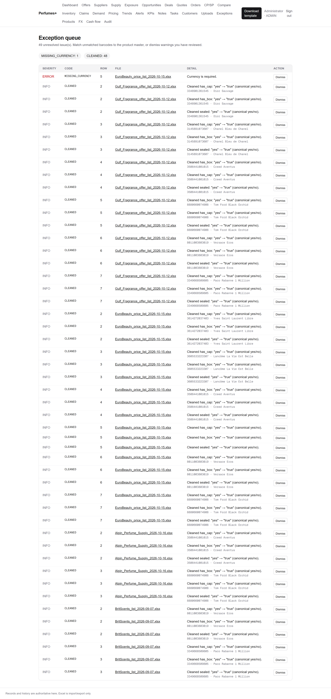

- The header tells you how many issues are unresolved.
- Issues are grouped by **code**. Common ones:
  - **MISSING_CURRENCY** (ERROR) — the row had no price currency. Fix the source
    file and re-import, or dismiss it if you have handled it another way.
  - **CLEANED** (INFO) — Perfumes+ tidied a value on import. These are
    informational and safe to **Dismiss**.
  - **UNMATCHED_CODE** — the barcode is not yet in the product master. **Match**
    it to an existing product, or ignore if the offer is not relevant.
- Click **Dismiss** to clear a row you have reviewed. Dismissing keeps the record
  in the audit trail.

Work the queue top-to-bottom until the unresolved count reaches zero. A clean
queue means every imported offer is trustworthy.

---

## 5. Supplier offers and the offer detail page

**Offers** is the master list of observed supply and prices over time. Each row
is a *dated observation from one supplier file* — it is not our own stock.

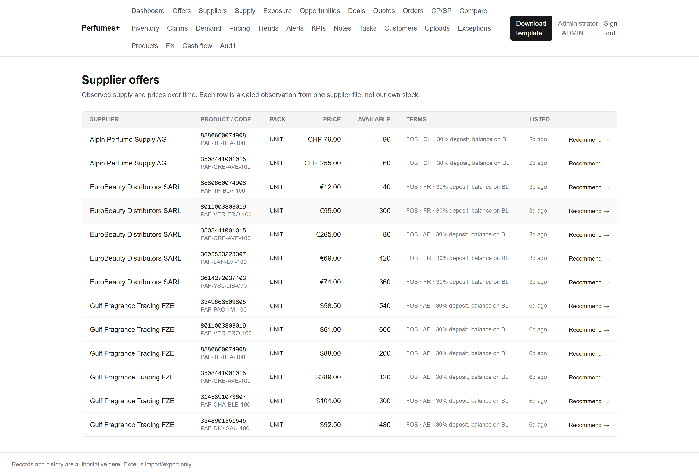

Columns show the **supplier**, the **product / code**, **pack**, **price** (in
the supplier's currency), **available** quantity, **terms**, and when it was
**listed**. Click **Recommend →** to open the offer detail page.

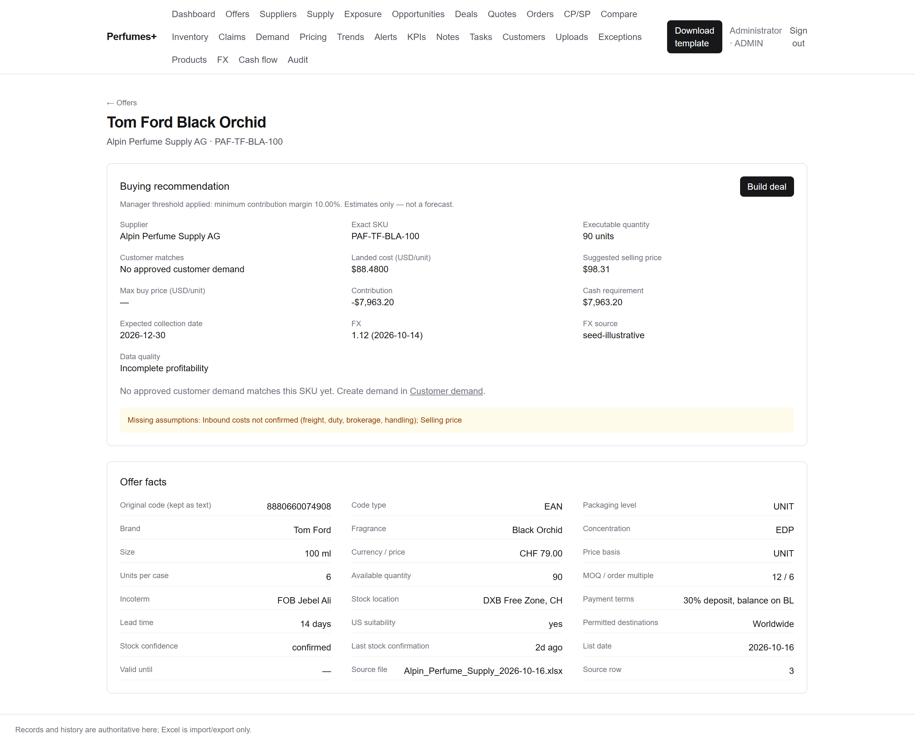

The offer detail page is where a buyer decides. It has three parts:

1. **Buying recommendation** — the supplier, exact SKU, executable quantity,
   whether there is matched customer demand, the **landed cost in USD/unit**, a
   **suggested selling price**, the maximum buy price, **contribution**, the cash
   required, the expected collection date, and which **FX rate** was used. A
   **Build deal** button starts a deal preloaded with this offer.
2. **Data quality** — any missing assumptions (for example "Inbound costs not
   confirmed") are listed so you know what to check before committing.
3. **Offer facts** — the raw fields: original code, code type, packaging level,
   brand, fragrance, concentration, size, currency and price, price basis, units
   per case, available quantity, MOQ / order multiple, incoterm, stock location,
   payment terms, lead time, US suitability, permitted destinations, stock
   confidence, last stock confirmation, list/valid dates, and the **source file
   and row**.

> The last line of every screen — *"Records and history are authoritative here;
> Excel is import/export only."* — is the core rule of the system.

---

## 6. The supplier scorecard

**Suppliers** ranks each supplier so you never buy on price alone.

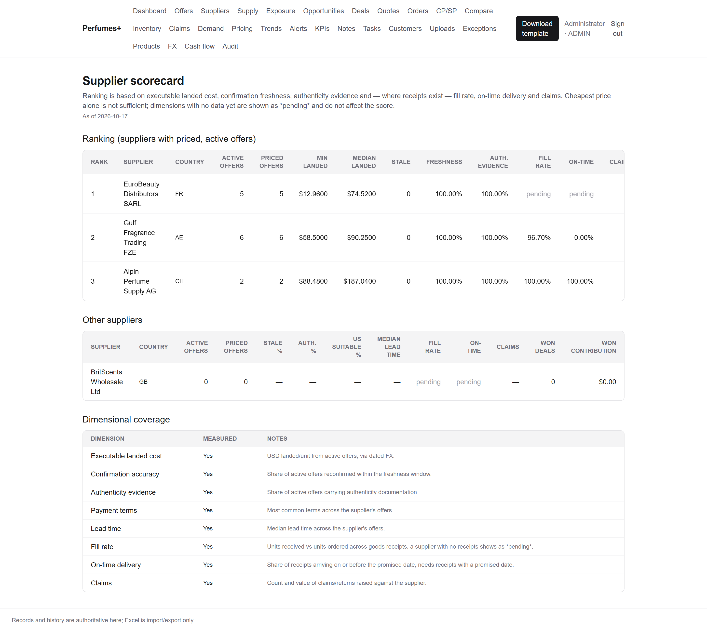

The score (0–100) blends **executable landed cost**, **confirmation freshness**,
**authenticity evidence**, and — once receipts exist — **fill rate**, **on-time
delivery** and **claims**. Dimensions with no data yet are shown as **pending**
and do not affect the score.

The **Ranking** table lists suppliers with priced, active offers: rank, country,
active and priced offers, minimum and median landed cost, staleness, freshness,
authenticity evidence, fill rate, on-time percentage, claims and payment terms.

**Other suppliers** (no priced offers yet) and a **Dimensional coverage** table
follow below, explaining what each dimension measures.

---

## 7. The product master

**Products** is the canonical list of the perfumes we trade. Barcodes from
supplier files map to these records through an alias table.

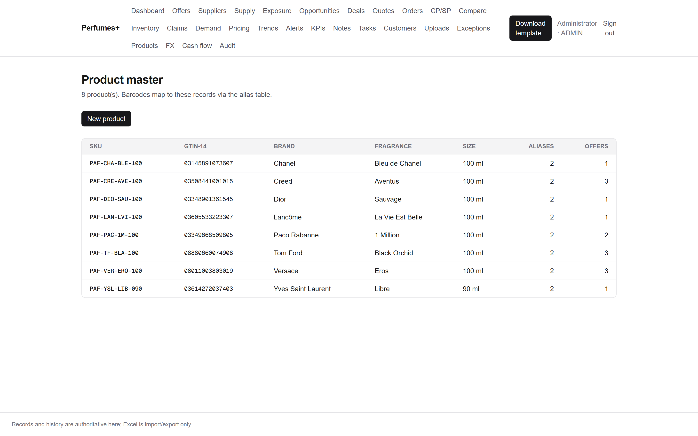

Columns: **SKU**, **GTIN-14**, **brand**, **fragrance**, **size**, number of
**aliases**, and number of **offers**. Click **New product** to add one; click a
row to open its detail page.

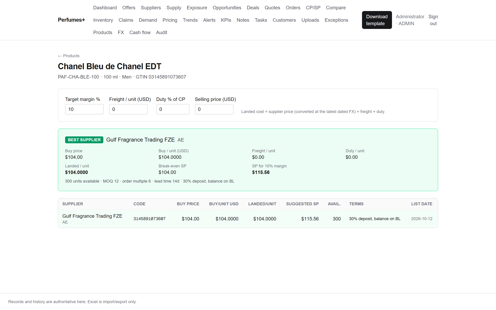

The product detail page lets you model landed cost and target price:

1. Enter a **Target margin %**, **Freight / unit (USD)**, **Duty % of CP** and an
   optional **Selling price (USD)**.
2. The **BEST SUPPLIER** panel shows the best current buy price, buy/unit in USD,
   freight, duty, **landed / unit**, the **break-even SP** and the **SP for your
   margin**.
3. The **supplier table** below compares every supplier offer for that product:
   code, buy price, buy/unit USD, landed/unit, suggested SP, availability, terms
   and list date.

*Landed cost = supplier price converted at the latest dated FX + freight + duty.*

---

## 8. Comparing price lists

**Compare** takes any two Excel files and shows what changed.

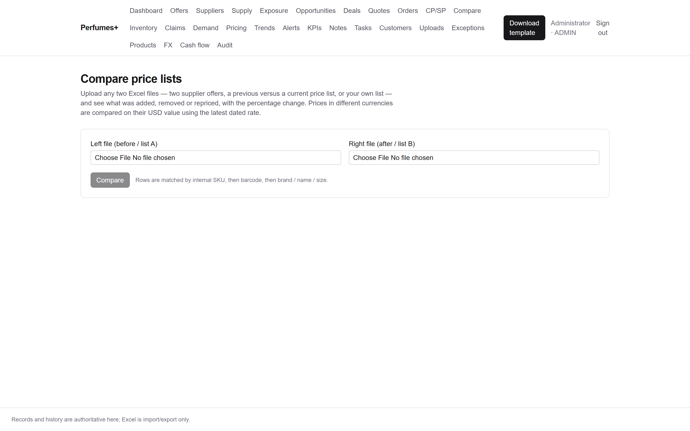

1. Upload the **Left file (before / list A)**.
2. Upload the **Right file (after / list B)**.
3. Click **Compare**.

Rows are matched by internal SKU, then barcode, then brand / name / size. The
result highlights **added**, **removed** and **repriced** rows with the
percentage change. Prices in different currencies are compared on their USD
value using the latest dated rate.

This is ideal for spotting a supplier who quietly raised prices between two
listings, or for diffing your own list against a competitor's.

---

## 9. Observed supply

**Supply** answers "how much stock really exists?" without double-counting.

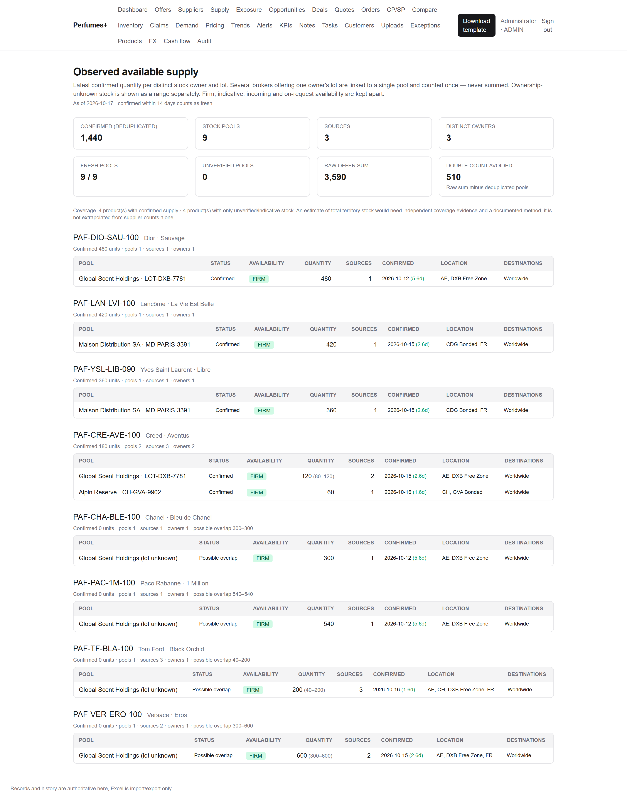

The key principle is shown in the header: several brokers offering **one owner's
lot** are linked to a single pool and **counted once — never summed**. The
summary cards show:

- **Confirmed (deduplicated)** units.
- **Stock pools**, **sources** and **distinct owners**.
- **Fresh pools** (confirmed within 14 days) versus **unverified pools**.
- **Raw offer sum** and **double-count avoided** (raw sum minus deduplicated
  pools).

Below, each product lists its pools with status, availability type (firm,
indicative, incoming, on-request), quantity, sources, confirmation date and age,
location and permitted destinations. Firm, indicative, incoming and on-request
availability are kept apart on purpose.

---

## 10. Exchange rates

**FX** stores dated exchange rates so every comparison is in USD.

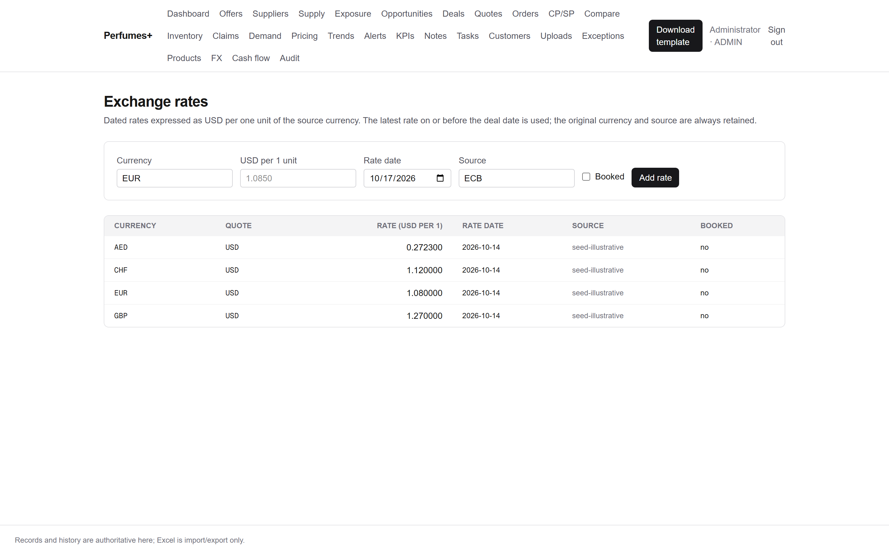

Rates are expressed as **USD per one unit** of the source currency. When a deal
is priced, the **latest rate on or before the deal date** is used, and the
original currency and source are always retained.

To add or update a rate, fill in the **Currency**, **USD per 1 unit**, **Rate
date**, **Source** and whether it is **Booked**, then click **Add rate**. The
table below lists every stored rate with its date and source.

---

## 11. Customer pricing

**Pricing** sets the minimum sell price per customer, using the same pricing
engine as every deal.

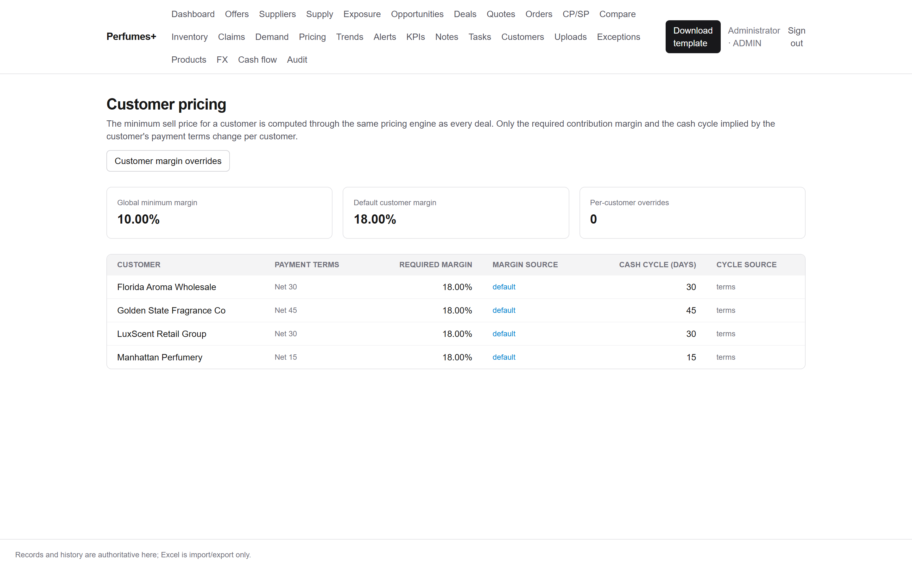

- **Global minimum margin** is the floor for everyone.
- **Default customer margin** applies when a customer has no override.
- **Per-customer overrides** let you require more (or less) margin for a
  particular account.
- The table shows each customer's **payment terms**, **required margin**, where
  that margin came from (**margin source**), the **cash cycle in days** implied
  by their terms, and the **cycle source**.

Because the required margin and the cash cycle are the only things that change
per customer, prices stay consistent across the whole book.

---

## 12. Price and supply trends

**Trends** shows how prices and supply move over time for each exact SKU.

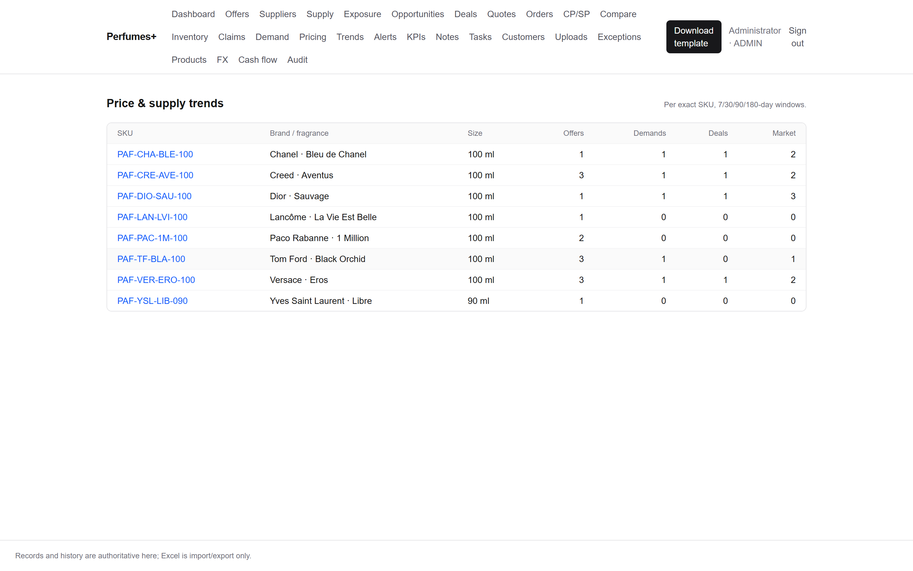

The list shows each SKU with counts of **offers**, **demands**, **deals** and
**market** observations. Click a row to open the trend detail.

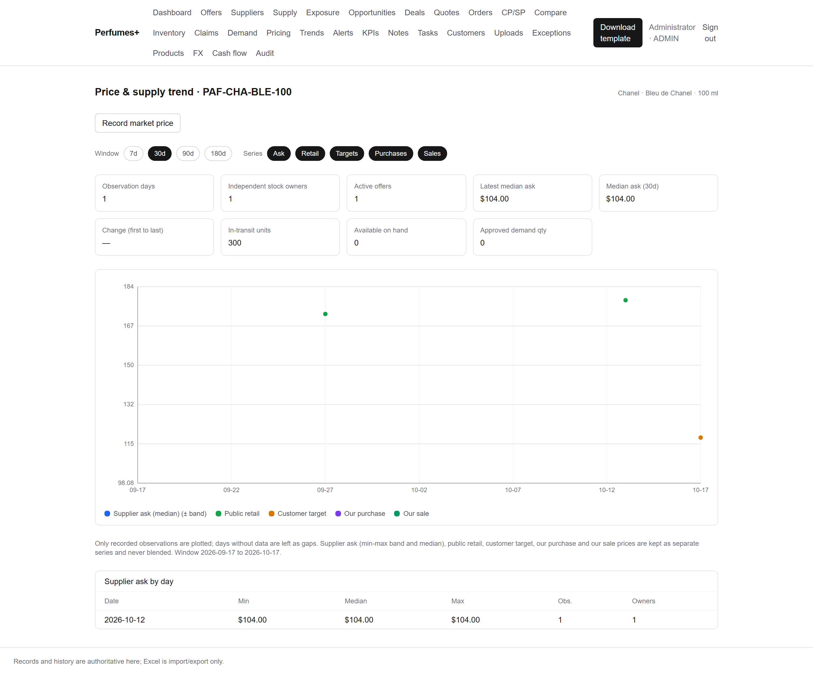

The detail page has:

- A **window** selector (**7d / 30d / 90d / 180d**) and toggles for each
  **series** (Ask, Retail, Targets, Purchases, Sales).
- Summary figures: observation days, independent stock owners, active offers,
  latest and 30-day median ask, the change from first to last, in-transit units,
  available on hand and approved demand quantity.
- A chart plotting each series separately. **Only recorded observations are
  plotted; days without data are left as gaps.** Series are never blended.
- A **Supplier ask by day** table with min, median, max, observations and owners.

Use **Record market price** to add an observation.

---

## 13. The CP/SP calculator

**CP/SP** is a quick two-way calculator for cost price and selling price.

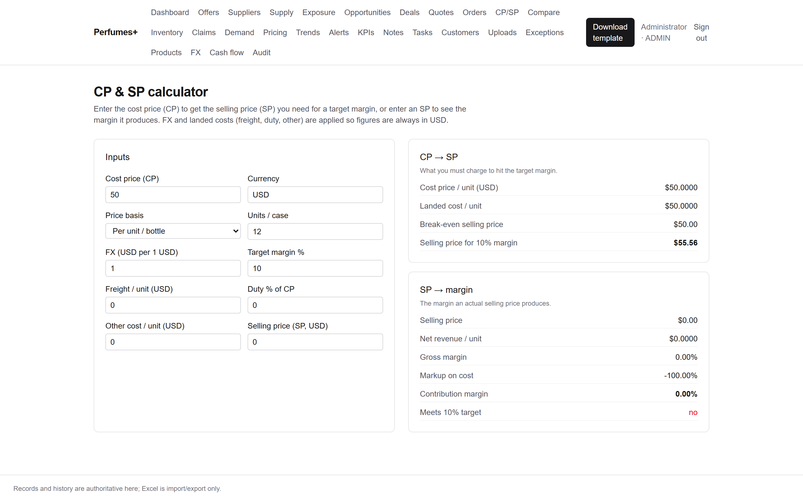

Fill in the **Inputs** — cost price (CP), currency, price basis (per unit or per
case), units per case, FX, target margin %, freight per unit, duty % of CP and
any other cost per unit — then use one of the two directions:

- **CP → SP** tells you the selling price you must charge to hit the target
  margin.
- **SP → margin** takes an actual selling price and shows the net revenue,
  gross margin, markup on cost and contribution margin, plus whether it meets
  the target.

All figures are shown in USD.

---

## 14. Sizing a deal

A **deal** is a proposed buy: one supplier, one product, one customer, a
quantity and a price. This is where buying decisions are made.

### Creating a deal

Open **Deals** and click **New deal**.

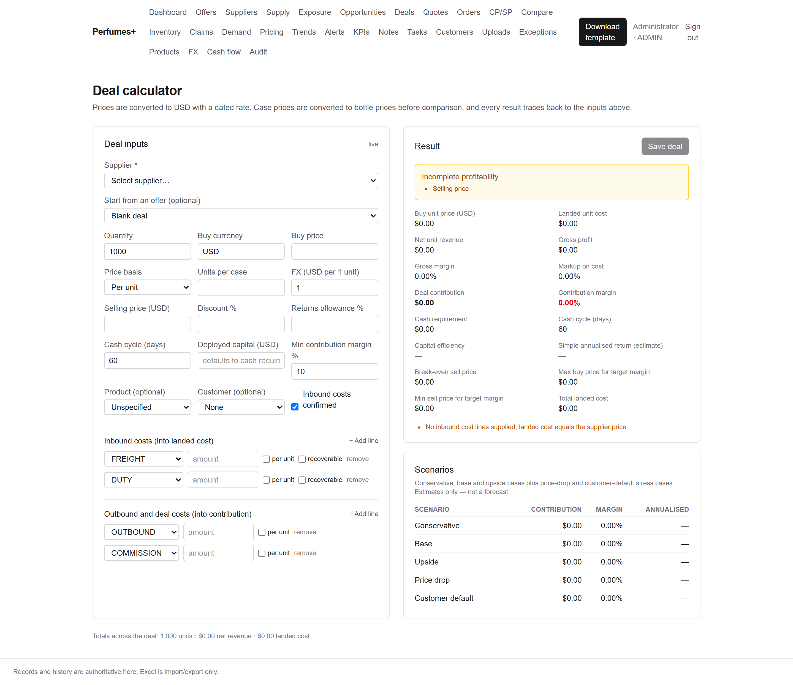

1. Choose a **Supplier**.
2. Optionally **Start from an offer** to prefill everything from a live offer,
   or leave it as a **Blank deal**.
3. Enter the **Quantity**, **buy currency** and **buy price** (and the price
   basis).
4. Add cost lines as needed — each cost is defined once, and **recoverable**
   amounts affect cash, not permanent cost.
5. The calculator converts case prices to bottle prices, converts to USD with
   the dated rate, and shows landed cost, contribution and cash return live.

### Reading a deal

Open any deal from the **Deals** list.

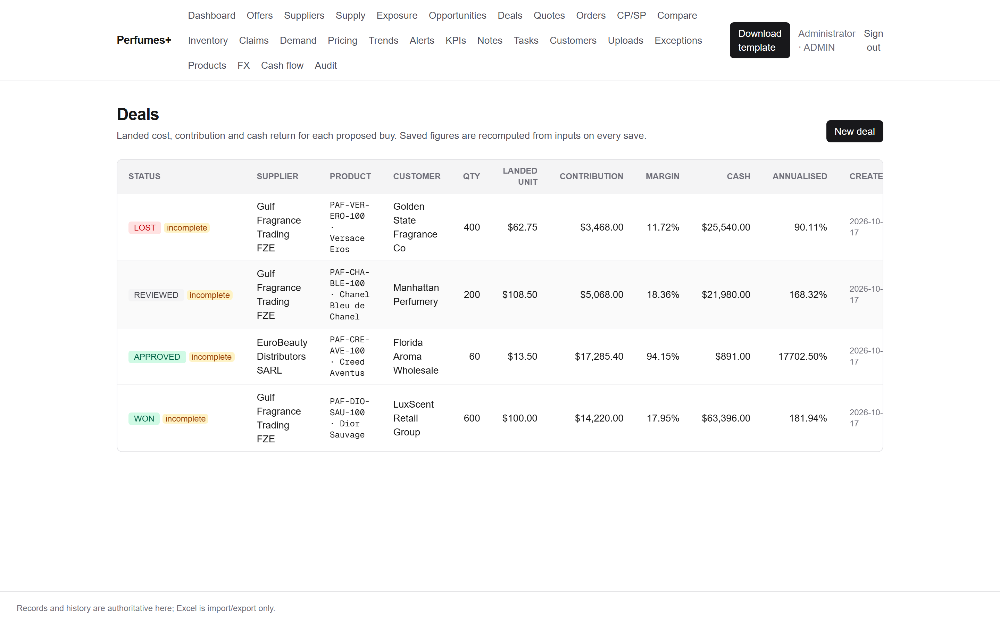

The list shows status, supplier, product, customer, quantity, landed unit cost,
contribution, margin, cash requirement and annualised return.

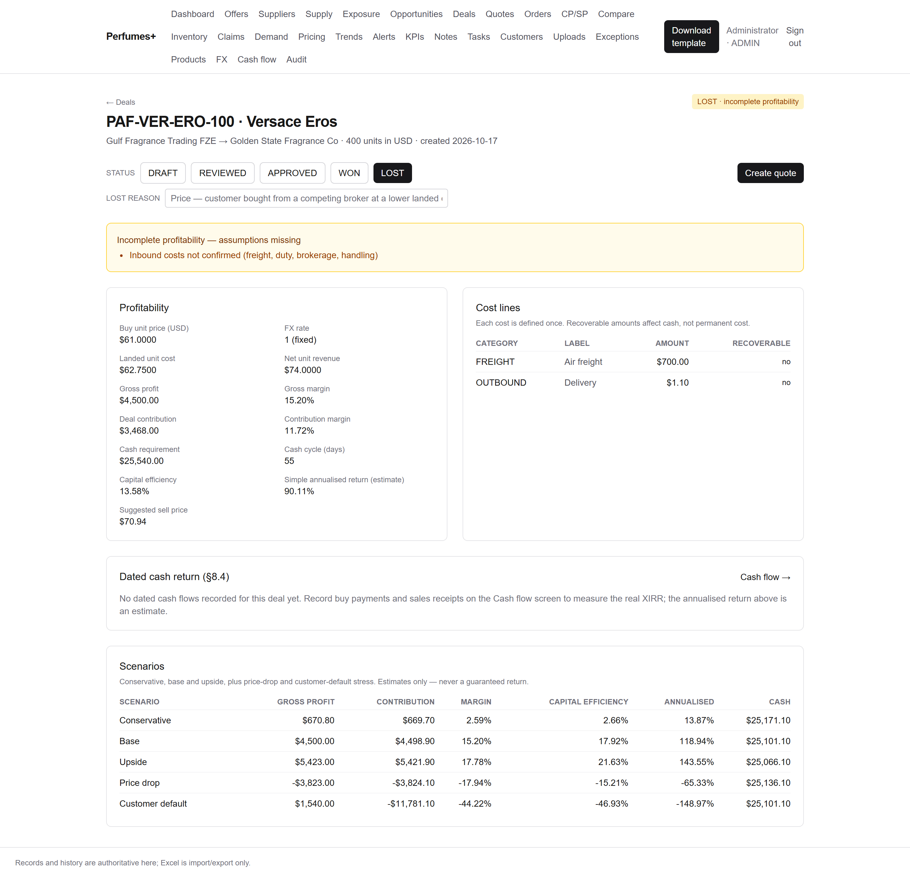

The detail page includes:

- **Status** buttons — **DRAFT**, **REVIEWED**, **APPROVED**, **WON**, **LOST**.
  A **LOST REASON** is recorded when a deal is marked LOST.
- **Profitability** — buy unit price, FX rate, landed unit cost, net unit
  revenue, gross profit, gross margin, deal contribution, contribution margin,
  cash requirement, cash cycle in days, capital efficiency, simple annualised
  return (an estimate) and the suggested sell price.
- **Cost lines** — every cost with its category, label, amount and whether it is
  recoverable.
- **Dated cash return (§8.4)** — once you record real buy payments and sales
  receipts for the deal on the Cash flow screen, this section shows the cash in,
  cash out, net, cash-on-cash percentage, **XIRR** and holding period. Until
  then it explains that the annualised figure above is only an estimate.
- **Scenarios** — conservative, base and upside, plus **price drop** and
  **customer default** stress tests. These are estimates only, never a
  guaranteed return.
- A **Create quote** button turns the deal into a customer-facing quote.

---

## 15. Opportunity ranking

**Opportunities** ranks the best executable offer for each live, approved
requirement.

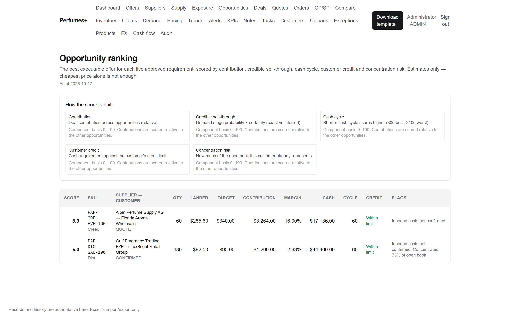

The **score** is built from five components, each explained on the page:

- **Contribution** — relative deal contribution.
- **Credible sell-through** — demand stage probability × certainty (exact vs
  inferred).
- **Cash cycle** — shorter cycles score higher (30 days best, 210 days worst).
- **Customer credit** — cash requirement against the customer's credit limit.
- **Concentration risk** — how much of the open book the customer already
  represents.

The table lists each opportunity's score, SKU, supplier → customer, quantity,
landed cost, target price, contribution, margin, cash, cycle, credit status and
any **flags** (for example "Inbound costs not confirmed").

---

## 16. Exposure and caps

**Exposure** guards against over-committing.

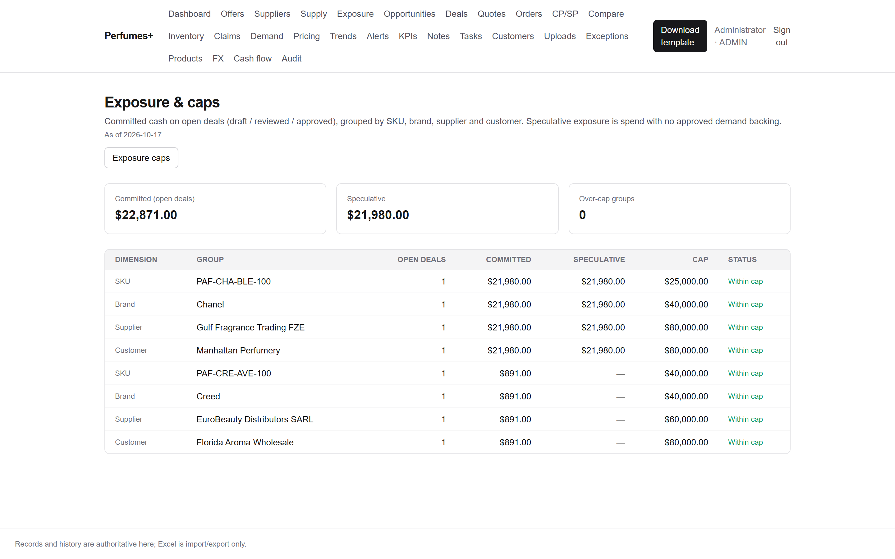

- **Committed (open deals)** is the cash tied up in draft, reviewed and approved
  deals.
- **Speculative** is spend with **no approved demand** backing it.
- **Over-cap groups** counts any group that has broken its cap.

The table groups committed and speculative cash by **SKU**, **brand**,
**supplier** and **customer**, and compares each group against its configured
**cap**, with a **Within cap** or **Over cap** status. Caps are configured by a
manager.

---

## 17. Customers

**Customers** is the account list.

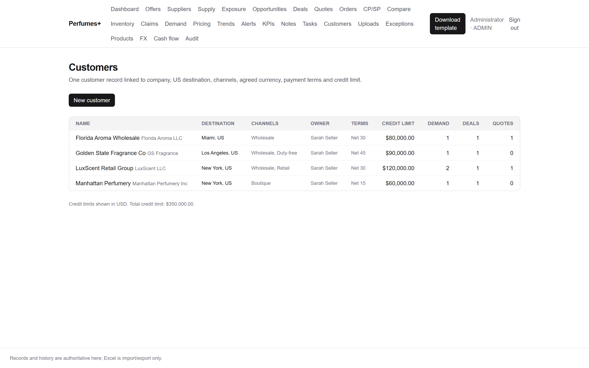

Each record links a company to a **US destination**, **channels**, an account
**owner**, **payment terms**, an agreed currency and a **credit limit**. Columns
also show how many **demand**, **deals** and **quotes** the customer has.

Click **New customer** to add one. Credit limits are shown in USD.

---

## 18. Customer demand

**Demand** records what each customer wants — at what price and quantity — as
separate, dated requirements.

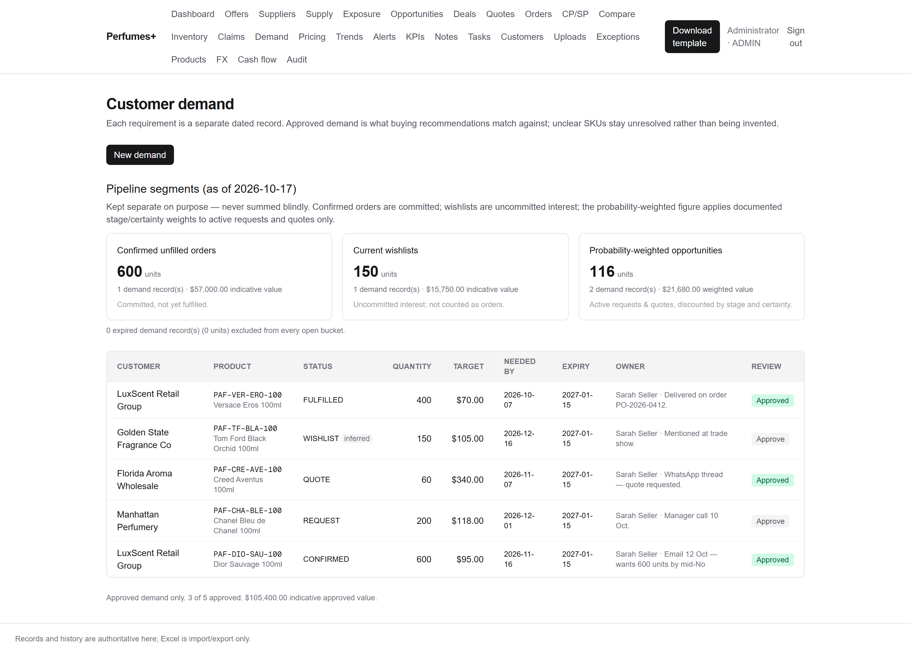

The **Pipeline segments** are deliberately kept apart and never summed blindly:

- **Confirmed unfilled orders** — committed, not yet fulfilled.
- **Current wishlists** — uncommitted interest.
- **Probability-weighted opportunities** — active requests and quotes discounted
  by documented stage/certainty weights.

Expired demand is excluded from every open bucket.

The table lists each requirement's customer, product, **status** (REQUEST,
QUOTE, WISHLIST, CONFIRMED, FULFILLED …), quantity, target price, needed-by date,
expiry, owner and review state. Approved demand is what buying recommendations
match against; unclear SKUs stay unresolved rather than being invented.

---

## 19. Quotes

**Quotes** are customer-facing quotations.

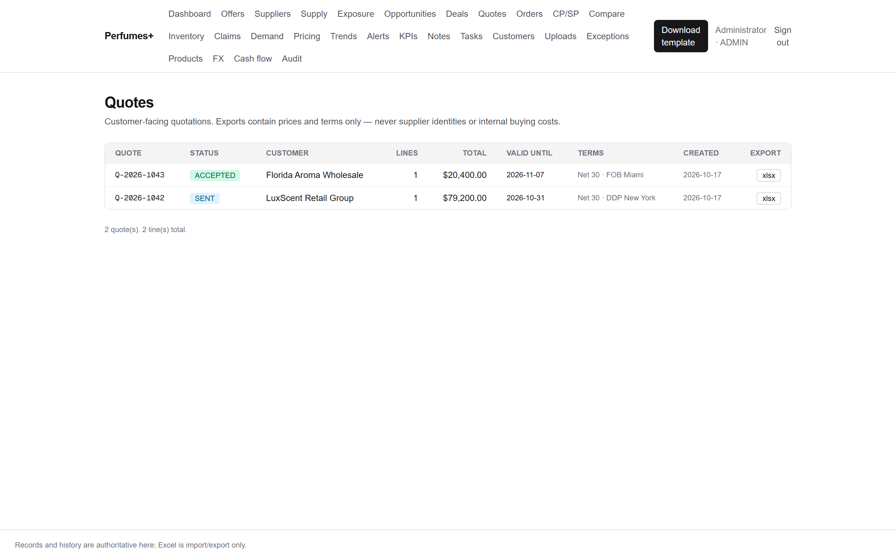

Each row shows the quote reference, status, customer, number of lines, total,
valid-until date, terms and creation date. **Exports (xlsx)** contain prices and
terms only — never supplier identities or internal buying costs.

---

## 20. Notes (Plaud / reMarkable / manual)

**Notes** capture meeting transcripts and turn them into structured claims.

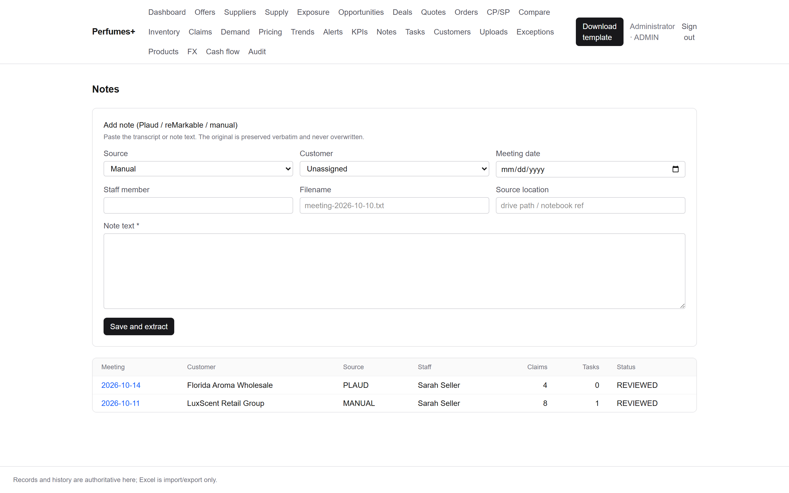

To add a note:

1. Choose the **Source** (Plaud, reMarkable or Manual) and the **Customer**.
2. Enter the **Meeting date**, **Staff member**, **Filename** and **Source
   location**.
3. Paste the **note text** (required).
4. Click **Save and extract**.

The original note is preserved **verbatim** and never overwritten. Extraction
produces claims (quantity, target price, product mentions and so on) that you
review individually.

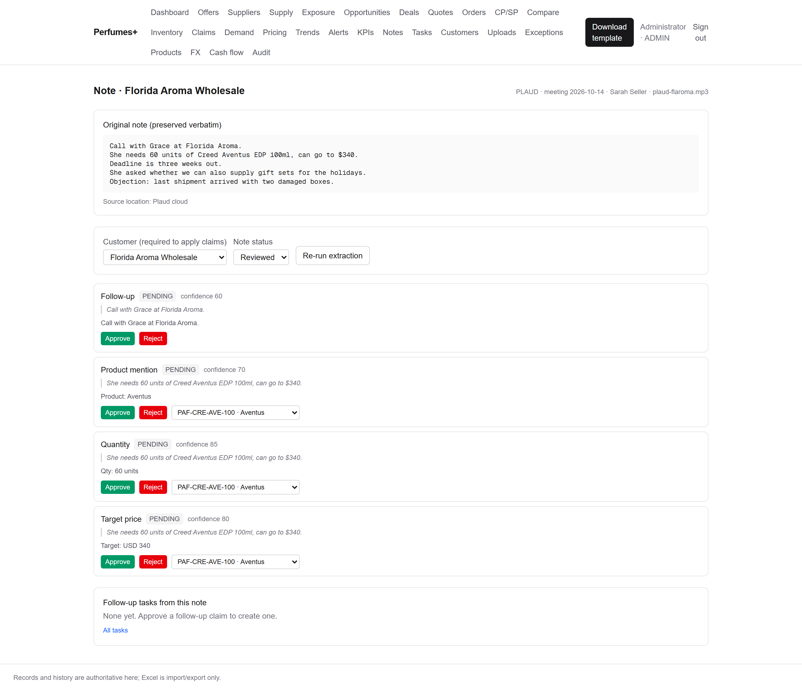

On the detail page, each extracted claim shows its **confidence** and the source
sentence, with **Approve** / **Reject** buttons and a **Link product…** selector
so you can attach a claim to the exact SKU. You can also set the note **status**
(Received / Reviewed / Archived) and **Re-run extraction**.

---

## 21. Follow-up tasks

**Tasks** is the shared to-do list.

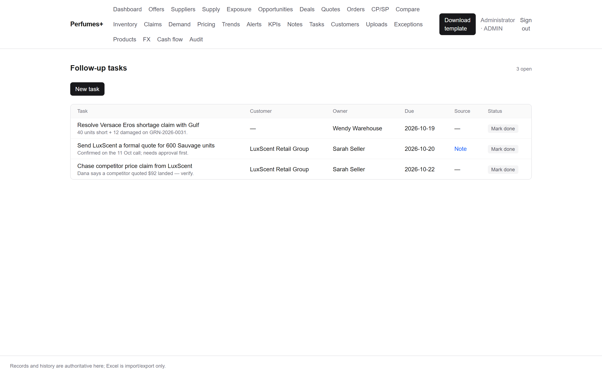

Each task has a description, an optional customer, an owner, a due date, and a
source (for example a note). Click **Mark done** to complete one, or **New task**
to add one. The header shows how many tasks are open.

---

## 22. Purchase orders

**Orders** places purchase orders with suppliers in whole-box quantities.

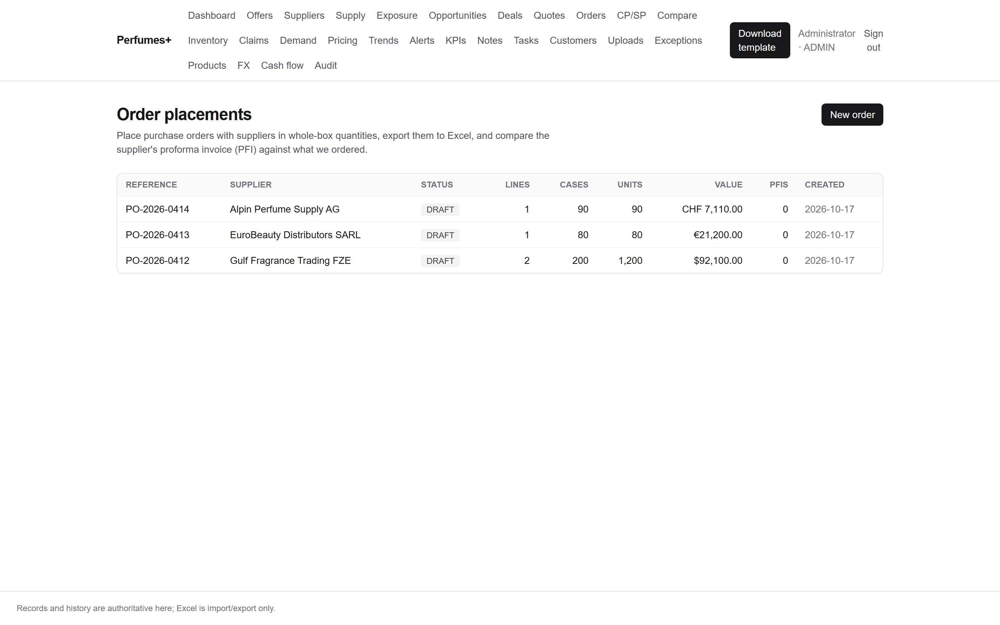

The list shows each order's reference, supplier, status, lines, cases, units,
value, number of PFIs and creation date. Click **New order** to create one.

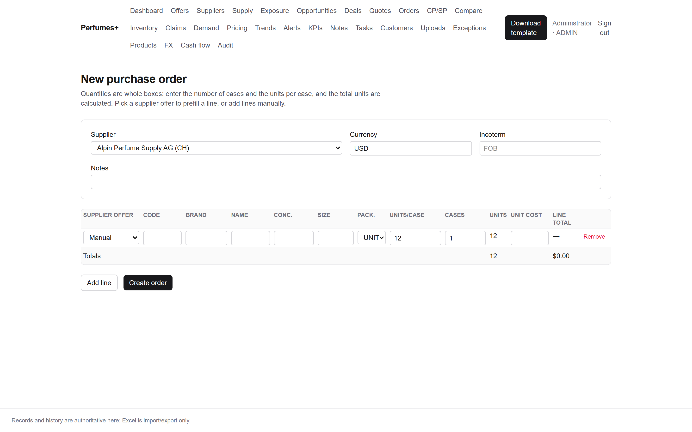

1. Choose the **Supplier**, **Currency** and **Incoterm**, and add any **Notes**.
2. Quantities are **whole boxes**: enter **units per case** and the number of
   **cases**, and the total units are calculated.
3. Pick a **supplier offer** to prefill a line, or add lines manually.
4. Click **Create order**.

Open an order to see it in full:

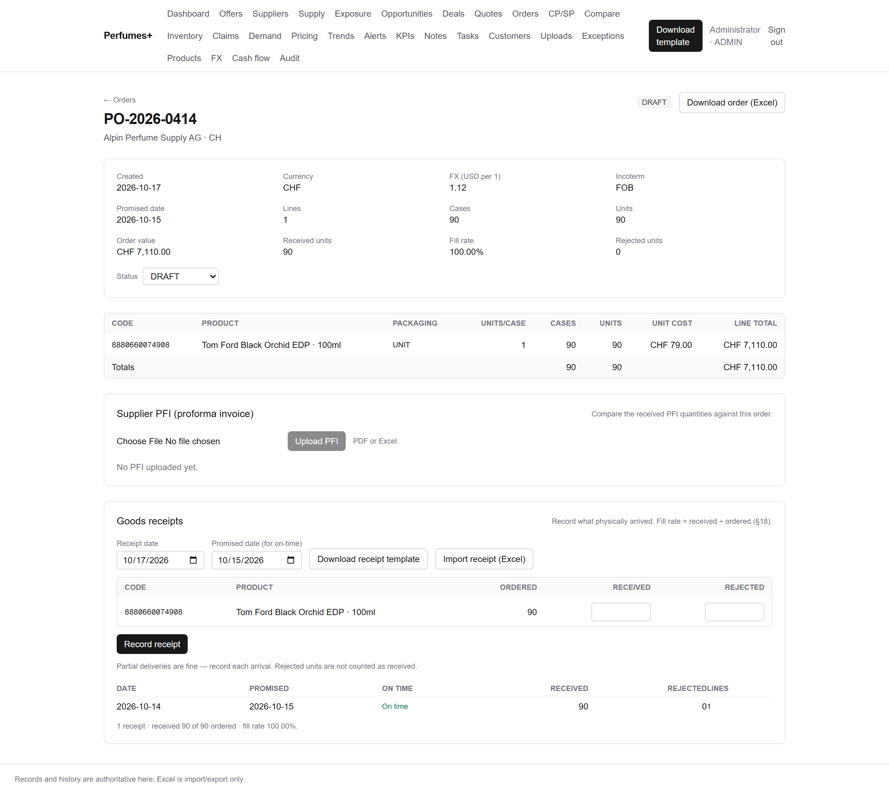

The order detail page shows the header summary (created date, currency, FX,
incoterm, promised date, lines, cases, units, order value, received units, fill
rate, rejected units and status), the line table, a **Download order (Excel)**
button, and the status stepper (DRAFT, SENT, CONFIRMED, RECEIVED, CANCELLED).
Below that are the PFI and goods-receipt sections (next section).

---

## 23. Goods receipts, PFI and fill rate

Goods receipts record **what physically arrived** against an order. They are
found on the order detail page.

**Supplier PFI (proforma invoice).** Upload the supplier's proforma (PDF or
Excel) to compare their stated quantities against what we ordered.

**Goods receipts.** To record an arrival:

1. Set the **Receipt date** and the **Promised date** (used for on-time
   measurement).
2. Enter the **received** and **rejected** units per line — you can download a
   **receipt template** or **import** a filled one.
3. Click **Record receipt**.

Partial deliveries are fine — record each arrival separately. **Rejected units
are not counted as received.** The page shows:

- **Fill rate** = received ÷ ordered (§18), accumulated across partial receipts.
- **On-time** = receipt date on or before the promised date.
- A receipt history table with date, promised date, on-time flag, received,
  rejected and line count.

Claims you log later (next section) count against the supplier's scorecard.

---

## 24. Inventory

**Inventory** is our own stock, by SKU, warehouse and lot.

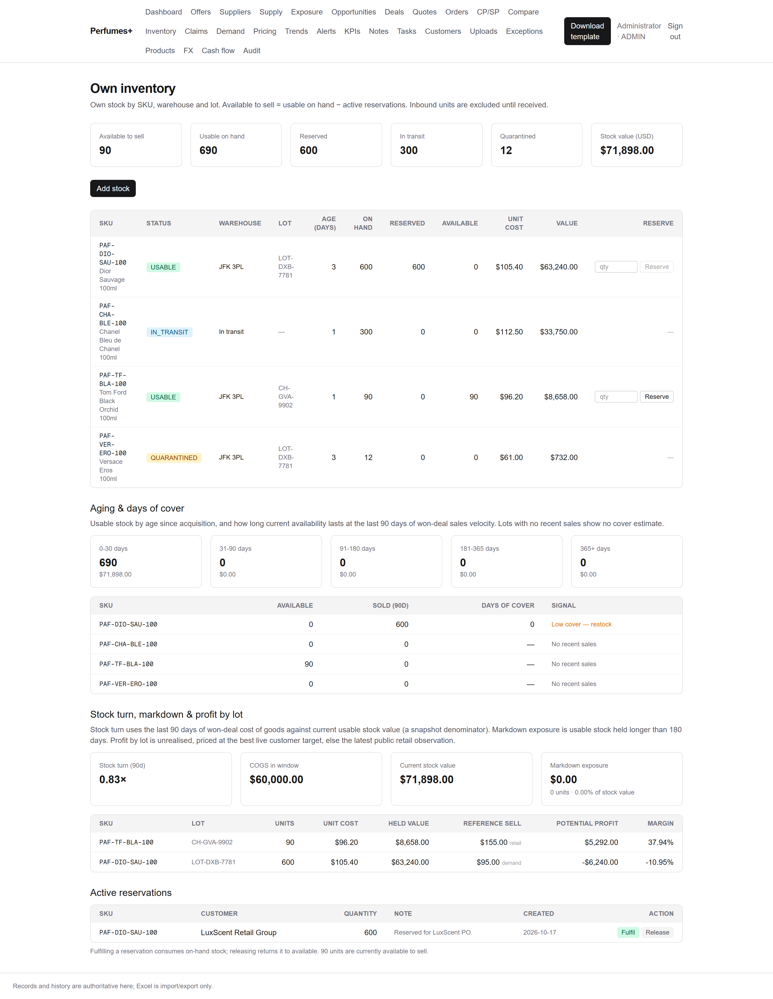

The summary cards show **Available to sell**, **Usable on hand**, **Reserved**,
**In transit**, **Quarantined** and **Stock value (USD)**.

> **Available to sell = usable on hand − active reservations.** Inbound units are
> excluded until received.

The table lists each stock line's SKU, status (USABLE, IN_TRANSIT, QUARANTINED …),
warehouse, lot, age in days, on hand, reserved, available, unit cost and value,
with a **Reserve** action.

Below that:

- **Aging & days of cover** — usable stock bucketed by age (0-30, 31-90, 91-180,
  181-365, 365+ days) and how long availability lasts at recent won-deal sales
  velocity, with a **Low cover — restock** or **No recent sales** signal.
- **Stock turn, markdown & profit by lot** — turnover using the last 90 days of
  won-deal cost of goods, plus markdown exposure for stock held over 180 days.

---

## 25. Supplier claims and returns

**Claims** logs shortages, damage, quality issues, late deliveries and returns.

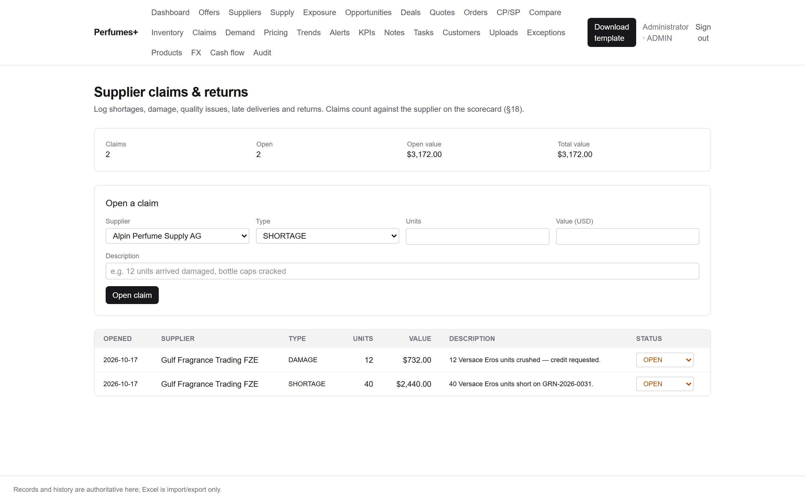

The cards show total claims, open claims, open value and total value. To open a
claim:

1. Choose the **Supplier** and the **Type** (SHORTAGE, DAMAGE, QUALITY, LATE,
   RETURN, OTHER).
2. Enter the **Units**, **Value (USD)** and a **Description**.
3. Click **Open claim**.

Each claim in the list can be moved to **OPEN**, **RESOLVED** or **REJECTED**.
Claims count against the supplier on the scorecard (§18).

---

## 26. Cash flow, invoices and financing

**Cash flow** is the money side of the business. Dated cash flows are the source
of truth for partial payments, outstanding balances, funding balances, financing
and XIRR (§8.4).

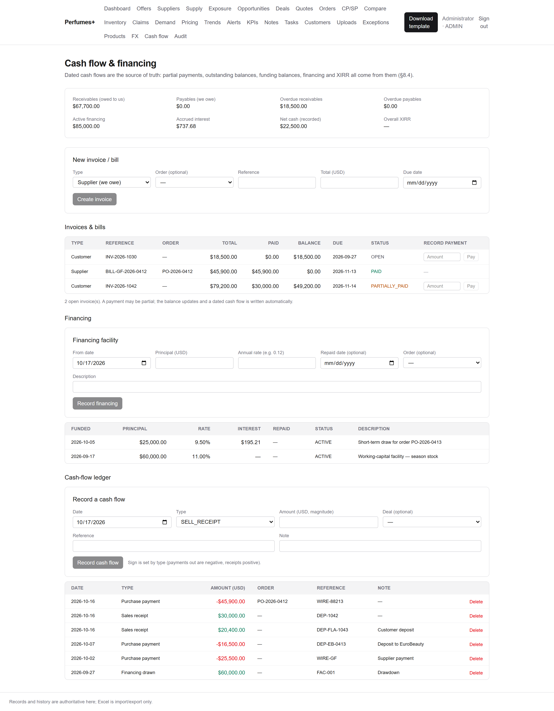

The summary cards show **Receivables (owed to us)**, **Payables (we owe)**,
**Overdue receivables**, **Overdue payables**, **Active financing**, **Accrued
interest**, **Net cash (recorded)** and the **Overall XIRR**.

### Invoices and bills

Use the **New invoice / bill** form:

1. Choose the **Type** — *Supplier (we owe)* or *Customer (they owe)*.
2. Optionally link an **Order**.
3. Enter a **Reference**, **Total (USD)** and **Due date**.
4. Click **Create invoice**.

The **Invoices & bills** table shows type, reference, order, total, paid, balance,
due date and status (OPEN, PARTIALLY_PAID, PAID). Use **Pay** to record a payment:
**a payment may be partial — the balance updates and a dated cash flow is written
automatically.**

### Financing

Use the **Financing** form to record a facility: financing name, from date,
principal (USD), annual rate (for example `0.12`), an optional repaid date, an
optional order, and a description. The table shows each facility's funded date,
principal, rate, accrued **interest**, repaid date, status and description.

Interest is calculated as `principal × annual rate × days ÷ 365`, rounded to
cents.

### Cash-flow ledger

The **Cash-flow ledger** records every dated movement. Use **Record a cash flow**
with a date, a **Type** (BUY_PAYMENT, SELL_RECEIPT, FINANCING_IN, FINANCING_OUT,
RECOVERABLE_REFUND, DEPOSIT_SUPPLIER, DEPOSIT_CUSTOMER, ADJUSTMENT and others), an
amount and an optional deal, then save. The sign of each type is fixed
automatically; a cash flow that is linked to a payment cannot be deleted.

Once a deal has real dated flows, its **Dated cash return (§8.4)** section (see
[section 14](#14-sizing-a-deal)) shows the measured XIRR instead of an estimate.

---

## 27. KPIs

**KPIs** tracks the business-wide measures.

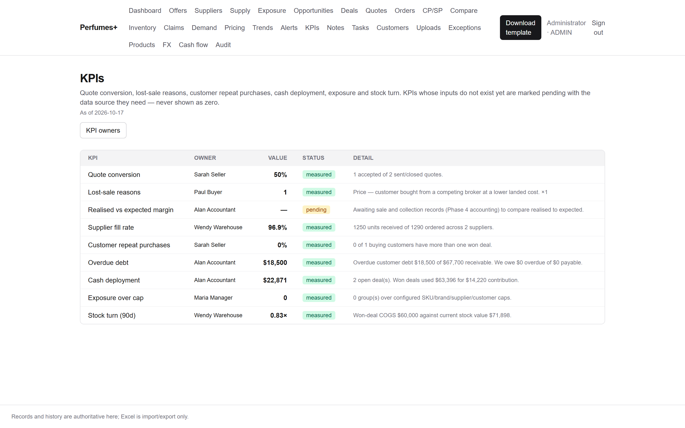

Each KPI has an **owner**, a **value**, a **status** and a **detail** line:

- **Quote conversion**, **Lost-sale reasons**, **Supplier fill rate**,
  **Customer repeat purchases**, **Overdue debt**, **Cash deployment**,
  **Exposure over cap**, **Stock turn (90d)** and more.

Crucially, KPIs whose inputs do not exist yet are marked **pending** with the
data source they need — they are **never shown as zero**.

---

## 28. Alerts

**Alerts** surfaces things that need a decision.

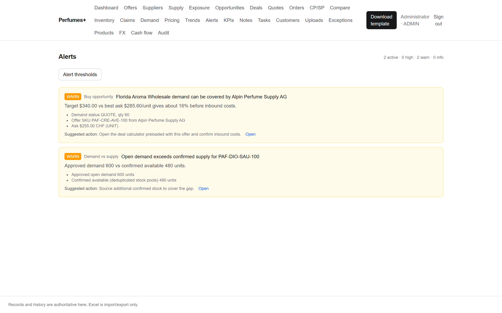

The header counts active, high, warn and info alerts. Each alert explains what
it detected, the numbers behind it, and a **Suggested action**, with an **Open**
button that jumps to the relevant screen. For example, a *Buy opportunity* alert
shows a customer demand that a supplier offer can cover, with the target versus
the best ask price.

---

## 29. Audit log

**Audit** is the immutable record of every sensitive change.

Every entry shows **when**, **who** (actor), the **action**, the **entity** and a
**Change** with a **view** link to the before/after values. The log is
append-only — entries are never edited or deleted. Use the **Entity type**,
**Action**, **Actor** and **Search** filters, and the **Rows** selector, to find
what you need.

---

## 30. Roles and what each one can see

Navigation is filtered by role, and pages you are not allowed to open show a
*Forbidden* message.

| Role | Areas |
| --- | --- |
| **Administrator** | Everything |
| **Manager** | Everything |
| **Purchasing** | Dashboard, market, purchasing, trading, warehouse |
| **Sales** | Dashboard, market, trading, sales |
| **Accounts** | Dashboard, trading, accounts (including cash flow, invoices, financing) |
| **Warehouse** | Dashboard, warehouse |

Typical responsibilities:

- **Purchasing** imports offers, ranks suppliers, sizes deals and places orders.
- **Sales** captures demand, creates quotes and manages customers and notes.
- **Warehouse** records goods receipts, manages inventory and raises claims.
- **Accounts** manages invoices, payments, financing and cash-flow recording.
- **Manager / Administrator** set caps, margins and KPI owners, and review
  exposure, alerts and the audit log.

---

## 31. Everyday workflows

**A buyer turning a supplier offer into an order**

1. **Uploads → Import** the new supplier file.
2. **Exceptions →** clear anything unresolved.
3. **Offers →** open the best-priced offer and check the landing cost and data
   quality.
4. **Deals → New deal**, start from that offer, add cost lines, and review the
   profitability and scenarios.
5. Set the deal to **APPROVED** once you are happy (check **Exposure** first).
6. **Orders → New order**, prefill the line from the offer, and **Create order**.
7. When stock arrives, record a **goods receipt** on the order and raise a
   **claim** if the delivery is short or damaged.

**A seller capturing demand and quoting**

1. **Demand → New demand** with the customer, product, quantity and target price.
2. Approve it once verified (it then drives buying recommendations).
3. **Opportunities** shows the best supplier to cover it.
4. Create a deal, then **Create quote** from the deal.
5. Send the quote; the **xlsx** export never reveals suppliers or costs.

**An accountant closing the loop**

1. **Cash flow → New invoice / bill** for what is owed.
2. Record **Pay** payments as money moves — partial payments are fine.
3. Record any **financing** drawdowns and check the accrued interest.
4. Record one-off movements in the **Cash-flow ledger**.
5. Revisit the deal's **Dated cash return (§8.4)** to see the measured XIRR.

**A manager reviewing the business**

1. **Dashboard** for the headline numbers.
2. **KPIs** for the measures and their owners (pending items show what is
   missing).
3. **Alerts** for anything needing a decision.
4. **Exposure** to confirm no cap has been broken.
5. **Audit** to see who changed what.
